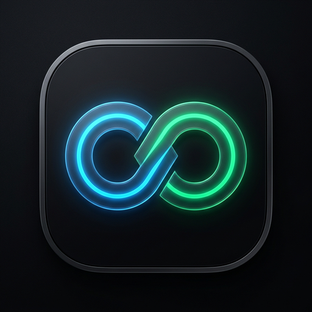

<p align="center">
  
</p>

<h1 align="center">PowerLab: Battery & Charging</h1>

<p align="center">
  <strong>Complete Android battery diagnostics, wakelock isolation, and charging hardware profiler.</strong>
</p>

<p align="center">
  
  
  
  
</p>

---

## Overview

**PowerLab** is a comprehensive, privacy-first diagnostic tool designed for both sides of your device's power lifecycle:

1. **Charging Telemetry (Power IN):** Benchmark USB cables, power bricks, and wireless chargers in real time. Measure actual wattage, net mA current, voltage, and thermal throttling curves to identify bottlenecked cables and slow chargers.
2. **Drain Diagnostics (Power OUT):** Isolate what drains your battery while the screen is off. PowerLab computes differential snapshots of Android internal diagnostic sources (`batterystats`, `dumpsys alarm`, `dumpsys power`) to pinpoint wakelock culprits without requiring root.

---

## Key Features

- **Charging & Hardware Benchmarking**: Real-time charging wattage, net current (mA), voltage, and battery temperature curves. Catalog and compare chargers, USB-C cables, and wireless pads.
- **Wakelock & Wakeup Culprit Detection**: Pinpoint apps and processes triggering partial wakelocks, kernel wakeups, alarms, and background CPU spikes.
- **24/7 Continuous Telemetry**: Background monitoring to record periodic snapshots and calculate screen-off deep sleep vs. awake ratios.
- **Session Benchmarks**: Dedicated recording sessions (overnight standby or fast charging runs) with differential before/after delta calculation.
- **100% Offline & Private**: Zero external network transmission. All metrics and diagnostic history remain on your local device in a sandboxed SQLite database.
- **Actionable Remediation**: Built-in prevention tips and direct shortcuts to app settings to restrict rogue background battery drain.
- **Diagnostics Export**: Export comprehensive HTML and CSV diagnostic reports for offline inspection or sharing.
- **Mock Diagnostic Mode**: Built-in mock telemetry source allowing complete UI testing without requiring elevated ADB permissions.

---

## Setup & ADB Permissions

PowerLab reads protected diagnostic stats that are not exposed to normal third-party apps by default. These can be granted once via ADB without rooting:

```bash
adb shell pm grant com.sneakyzippy.powerlab android.permission.BATTERY_STATS
adb shell pm grant com.sneakyzippy.powerlab android.permission.DUMP
adb shell pm grant com.sneakyzippy.powerlab android.permission.PACKAGE_USAGE_STATS
adb shell pm grant com.sneakyzippy.powerlab android.permission.INTERACT_ACROSS_USERS
adb shell appops set com.sneakyzippy.powerlab GET_USAGE_STATS allow
```

*One-Line Setup:*
```bash
adb shell "pm grant com.sneakyzippy.powerlab android.permission.BATTERY_STATS; pm grant com.sneakyzippy.powerlab android.permission.DUMP; pm grant com.sneakyzippy.powerlab android.permission.PACKAGE_USAGE_STATS; pm grant com.sneakyzippy.powerlab android.permission.INTERACT_ACROSS_USERS; appops set com.sneakyzippy.powerlab GET_USAGE_STATS allow"
```

*Note: If you don't have ADB available, you can tap **Proceed (Demo)** or toggle **Mock Diagnostic Mode** in settings to test all features with simulated data.*

---

## Tech Stack

- **UI**: Jetpack Compose, Material 3
- **Language**: Kotlin 2.0+ (Coroutines, Flow)
- **Architecture**: MVVM with unidirectional data flow
- **Storage**: Room SQLite database
- **Target SDK**: Android 14 (API 34) / Min SDK 26

---

## License

This project is licensed under the terms of the GNU General Public License v3.0 ([GPL-3.0](LICENSE)).
